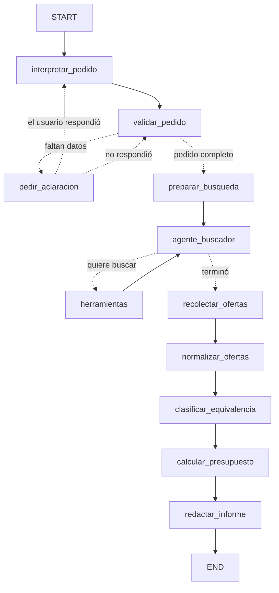

# Agentes de compras de mercado 

Ejercicio académico: una solicitud de compra entra por consola, un LLM de OpenAI la
convierte en un pedido estructurado con **salida estructurada**, un agente consulta los
catálogos de varios proveedores con sus **herramientas**, el grafo normaliza unidades y
compara precios, y entrega un presupuesto por tienda, una alternativa combinada y un
informe con los enlaces de cada precio.

**Entregable 4 — Técnicas Avanzadas de IA**
Integrantes: Camilo Andrés Armenta y Simón Sánchez Gómez.

## Objetivo

Los catálogos de los supermercados no se pueden comparar directamente: cambian los
nombres, las marcas, las presentaciones y las unidades. El objetivo es un agente que, a
partir de una lista de compra escrita en lenguaje natural, consulte al menos dos
proveedores, compare lo que sí es comparable y entregue un presupuesto respaldado por
fuentes verificables, declarando lo que no pudo verificar.

## Dónde está cada entregable

| Entregable | Dónde |
|---|---|
| La solución (grafo, nodos, herramientas) | `cotizador/` y `main.py` |
| Informe generado por el agente | `informes/informe.docx` |
| Memoria del proyecto: desarrollo, arquitectura, decisiones y resultados | `Memoria del Proyecto.docx` |
| Recorrido del sistema pieza por pieza, ejecutable | `notebooks/cotizador.ipynb` |
| Pruebas automáticas | `tests/` |
| Catálogos de precios con sus fuentes | `datos/catalogos/` |
| Diagrama del grafo | `docs/grafo.mmd` y en este README |

## Tecnologías

| Tecnología | Versión | Para qué |
|---|---|---|
| Python | 3.12 | Lenguaje |
| uv | — | Entorno y dependencias reproducibles (`uv.lock`) |
| LangGraph | 1.2.20 | El grafo: estado, nodos, aristas condicionales, ciclos, `interrupt()` |
| LangChain (`langchain-core`, `langchain-openai`) | 1.7.7 / 1.7.4 | Prompts, cadenas, herramientas y conexión con OpenAI |
| OpenAI `gpt-4o-mini` | — | El modelo, con salida estructurada (`json_schema` estricto) |
| Pydantic | 2.14.3 | Modelos de datos y validación del estado |
| python-docx | 1.2.0 | El informe en Word |
| pytest | 9.2.0 | Pruebas sin red ni clave |

## Instalación y ejecución

El proyecto se gestiona con [uv](https://docs.astral.sh/uv/) (Python 3.12; uv descarga
el intérprete si hace falta).

```bash
uv sync                            # crea .venv e instala dependencias según uv.lock

cp .env.example .env               # y pega tu OPENAI_API_KEY dentro

uv run python main.py                                      # pregunta la solicitud
uv run python main.py --texto "Necesito 2 kg de arroz y 2 litros de aceite en Exito y Carulla"
uv run python main.py --texto "..." --informe informes/informe.docx   # informe en Word
uv run python main.py --mermaid                            # dibuja el grafo (no usa OpenAI)
uv run pytest                                              # pruebas con LLM falso (sin API)
```

La clave de OpenAI se lee del archivo `.env`, que está en `.gitignore` y **nunca** se sube
al repositorio. `.env.example` es la plantilla, sin credenciales. `config.py` oculta la
clave al imprimir la configuración, y los errores del modelo se traducen a una línea sin
mostrarla nunca.

Si no hay cantidad en la solicitud, el agente **se detiene y pregunta** antes de cotizar.

## Flujo del grafo



Hay **tres aristas condicionales** (validación, aclaración y búsqueda) y **dos ciclos**:
el de aclaración con el usuario y el del agente con sus herramientas. Los dos tienen tope
(`MAX_ACLARACIONES` y `MAX_VUELTAS`): un ciclo sin condición de salida y sin límite es un
ciclo infinito esperando el momento. Las funciones de ruteo están en `cotizador/routers.py`.

La pausa para preguntar usa `interrupt()` con un *checkpointer*: el grafo guarda su estado,
sale, y se reanuda con `Command(resume=...)` cuando llega la respuesta. Quien responda
puede ser la consola, un cuaderno o una API.

## Flujo de datos por nodo

Convención: cada nodo **recibe** el estado (`EstadoCompra`, modelo Pydantic) y **devuelve un
diccionario** solo con los campos que actualiza.

| Nodo | Lee del estado | Devuelve (dict) | ¿Usa el LLM? |
|---|---|---|---|
| `interpretar_pedido` | `texto_usuario` | `pedido`, `historial` | Sí |
| `validar_pedido` | `pedido`, `aclaraciones` | `datos_faltantes`, `suposiciones`, `historial` | No |
| `pedir_aclaracion` | `datos_faltantes` | `texto_usuario`, `aclaraciones`, `hubo_respuesta` | No |
| `preparar_busqueda` | `pedido` | `proveedores_consultados`, `mensajes` | No |
| `agente_buscador` | `pedido`, `mensajes` | `mensajes`, `historial` | Sí |
| `herramientas` (`ToolNode`) | `mensajes` | `mensajes` | No |
| `recolectar_ofertas` | `mensajes`, `pedido` | `resultados`, `historial` | No |
| `normalizar_ofertas` | `resultados` | `resultados`, `historial` | No |
| `clasificar_equivalencia` | `resultados` | `resultados`, `historial` | Sí |
| `calcular_presupuesto` | `resultados` | `presupuestos`, `combinado`, `suposiciones` | No |
| `redactar_informe` | todo el estado | `informe`, `historial` | Solo la recomendación |

`historial` y `suposiciones` usan un *reducer* (`operator.add`): cada nodo agrega líneas sin
borrar las anteriores. `mensajes` usa `add_messages`, que respeta los identificadores de cada
llamada a herramienta.

## Qué hace el LLM y qué hace el código

Es la decisión de diseño que atraviesa todo el proyecto.

- **El LLM interviene donde hay lenguaje**: entender la solicitud, decidir qué buscar,
  juzgar si una oferta responde a lo pedido, y redactar la recomendación.
- **Las cuentas van en código Python**: conversión de unidades, precio por kg o L, cuántos
  empaques enteros hacen falta, totales y compra combinada. Son reproducibles y se prueban.

Por eso las conversiones se guardan como fracciones (1 kg = 1000/1 g) en vez de decimales:
un error de coma flotante podría hacer comprar un empaque de más al redondear hacia arriba.

En el informe, **el modelo solo escribe el párrafo de recomendación** y recibe las cifras ya
calculadas. Después, el código extrae los números de ese párrafo y comprueba que cada cifra
de dinero exista entre las calculadas; si aparece una que no, descarta el párrafo entero y
usa uno escrito por código.

## Lo que entrega el informe

Las seis salidas que pide el enunciado, en Word o en Markdown según la extensión:

| Sección | Salida exigida |
|---|---|
| 1. Solicitud y productos identificados | Tabla de productos solicitados |
| 2. Ofertas encontradas | Ofertas, con precio por unidad y clasificación |
| 3. Compra completa por proveedor | Presupuesto por proveedor |
| 4. Alternativa combinada | Compra combinada, cuando es viable |
| 5. Totales y costos adicionales | Costo total y costos conocidos |
| 6. Sin cotización y condiciones no verificadas | Lo que no se pudo cotizar |
| 7. Recomendación | Recomendación explicada |
| 8. Fuentes consultadas | Enlaces y fecha de consulta de cada precio |

**El envío desconocido no se trata como cero.** Los catálogos no lo publican, así que el
subtotal de productos es el único valor confirmado y el total final queda declarado como
pendiente de verificar, no estimado en cero.

Cada oferta conserva nombre, marca, presentación, precio, moneda, proveedor, URL y fecha de
consulta, de modo que cualquier cifra del informe se puede rastrear hasta su fuente.

## Fuentes de precios

Tres catálogos CSV en `datos/catalogos/`, armados desde las páginas públicas de cada tienda
con su URL y su fecha de consulta:

| Proveedor | Ofertas | Origen |
|---|---|---|
| Éxito | 53 | Páginas públicas de producto |
| Carulla | 53 | Páginas públicas de producto |
| Ara | 16 | Folleto semanal público (Ara no publica precios por producto en línea) |

Se revisó el `robots.txt` de los tres sitios antes de consultarlos, y se usó el precio
general, no el de tarjeta de afiliado. Una muestra se verificó contra el JSON-LD de cada
página. Los detalles están en `datos/catalogos/README.md`.

## Estructura

```
Entregable 4 final/
├── README.md                    # este archivo
├── Memoria del Proyecto.docx    # desarrollo, arquitectura, decisiones y resultados
├── main.py                      # CLI: --texto, --informe, --mermaid
├── pyproject.toml               # dependencias, grupo dev y config de pytest (uv)
├── uv.lock                      # versiones exactas (se sube al repositorio)
├── .python-version              # versión de Python para uv
├── .env.example                 # copiar a .env (la clave nunca se sube)
├── docs/grafo.mmd               # diagrama Mermaid generado con --mermaid
├── datos/catalogos/             # exito.csv, carulla.csv, ara.csv y su README
├── notebooks/cotizador.ipynb    # recorrido del sistema, pieza por pieza
├── cotizador/
│   ├── config.py                # lectura de .env, con la clave oculta
│   ├── errores.py               # traduce los errores de OpenAI a una línea
│   ├── schemas.py               # modelos Pydantic: pedido, oferta, presupuesto, informe
│   ├── prompts.py               # los cuatro prompts del sistema
│   ├── llm.py                   # ChatOpenAI + with_structured_output(json_schema, strict)
│   ├── catalogos.py             # lee los CSV y los convierte en ofertas
│   ├── busqueda.py              # búsqueda por palabras normalizadas
│   ├── unidades.py              # conversiones, precio unitario, empaques enteros
│   ├── presupuesto.py           # elección de empaque, totales y compra combinada
│   ├── informe.py               # el informe como datos, y en Markdown
│   ├── informe_word.py          # el mismo informe, en .docx
│   ├── ejecutar.py              # atiende las pausas de interrupt() y reanuda
│   ├── routers.py               # las tres funciones de enrutamiento
│   ├── grafo.py                 # StateGraph: nodos, aristas, compile()
│   ├── herramientas/            # una herramienta de búsqueda por proveedor
│   └── nodos/                   # un archivo por nodo
├── informes/informe.docx        # informe generado por el agente
└── tests/                       # 177 pruebas, sin red ni clave real
```

## Pruebas

```bash
uv run pytest -q
```

**177 pruebas, todas sin red y sin clave**: el LLM se reemplaza por funciones falsas con
guion, inyectadas en `construir_grafo(...)`. Así se verifica la orquestación —quién llama a
quién, cuándo se corta un ciclo, qué se recolecta— sin depender de lo que decida un modelo
real. Hay pruebas que comprueban lo contrario de lo esperado: un modelo que desobedece una
instrucción del prompt, y otro que inventa un precio en la recomendación.
